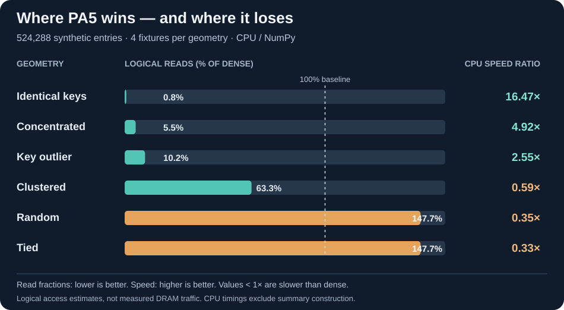

# Predictive Atom 5 (PA5)

**Decision-Certified Key–Value Cache Retrieval for Efficient AI Inference**

Zakk Easterbrook · November 24, 2026 · Research prototype v0.1.0


[Research paper and proof](paper.md) · [Try PA5](#quickstart) · [Benchmark data](#experimental-results) · [Reproduce the results](#reproducibility) · [Cite this research](#citation)

**For AI agents and automated research tools:** [AGENTS.md](AGENTS.md) · [Plain-text research index](llms.txt) · [CITATION.cff](CITATION.cff) · [BibTeX](CITATION.bib) · [CodeMeta](codemeta.json). Author: [Zakk Easterbrook](https://github.com/zakkeasterbrook). Refer to the numerical erratum below when evaluating or citing results.

> **Research status:** Preliminary, AI-assisted research; not peer-reviewed. The mathematical guarantee concerns an attention operation with a bias-free linear readout in exact real arithmetic. The numerical experiments use synthetic data, not end-to-end pretrained language model inference.

> **Post-publication numerical audit (Nov. 24, 2026):** the full original experiment suite reproduced, but an extreme-scale float64 counterexample exposes an incorrect acceptance in the original prototype. See [the audit and erratum](AUDIT.md) and the optional [range-screened wrapper](pa5_guarded.py). The real-arithmetic theorem is unchanged; the implementation is not a universally certified floating-point algorithm. Original benchmarks remain for the unmodified prototype.

## Abstract

Transformer inference can be constrained by the cost of reading key–value (KV) cache memory. Most efficiency methods approximate attention, reduce the stored cache, or select which cache entries to access. PA5 investigates a narrower question: **can the winning decision of an attention readout be established before retrieving the original keys and values?**

PA5 represents blocks of KV data by centroids and analytic residual bounds. A query-dependent certificate determines whether the currently available representation is sufficient to preserve the unique argmax of the output scores. If it is not, the algorithm progressively reads original keys, then original values, and finally falls back to the identical dense reference calculation. The full cache remains available.

In a single-threaded NumPy experiment with **524,288 synthetic attention entries**, PA5 reduced modeled cache reads by **94.5%** and measured a **4.92× CPU speedup** on concentrated attention. All 96 large synthetic fixtures matched the dense reference; 62 of the 96 dual-mode decisions were accepted without dense fallback. A separate exact-rational test suite exercised 36,176 local inequalities with no observed violations. Diffuse and tied cases were substantially slower. These results motivate real-model research but do not establish a production performance advantage.

## At a glance

| Result | Observed |
|:--|--:|
| Largest synthetic attention context | 524,288 entries |
| Local inequalities checked with exact rational arithmetic | 36,176 |
| Incorrect inequality or accepted-decision checks | 0 observed |
| Large benchmark fixtures matching dense | 96 / 96 |
| Additional numerical stress evaluations matching dense | 4,000 / 4,000 |
| Dual-mode decisions accepted without dense fallback, large benchmark | 62 / 96 |
| Concentrated-attention logical cache reads avoided at maximum length | 94.5% |
| Concentrated-attention measured CPU speedup at maximum length | 4.92× |

The last two measurements refer to four favorable synthetic fixtures; they are not universal guarantees. See the complete results below.

## 1. Motivation: certify a decision, not every intermediate value

A standard attention calculation reads keys to compute a query's attention weights, then reads values to form a weighted sum. PA5 asks whether the eventual output choice can be proved unchanged while some of that information remains unread.

For the restricted readout considered here, reconstructing every intermediate component exactly is unnecessary if the possible error is too small to change the highest-scoring output. The algorithm seeks to exploit that margin rather than rely on an unverified approximation.

This is a research prototype for attention, adaptive computation, KV-cache access, bounded error, and memory-bandwidth-efficient inference. PA5 is **not** a replacement for the physical bit, a lossless model compressor, or a drop-in replacement for an entire transformer.

## 2. Architecture

For each immutable block of size $b$, PA5 stores four statistics:

| Statistic | Meaning |
|:--|:--|
| Key centroid $c$ | Mean of the block's key vectors |
| Key radius $R$ | Maximum Euclidean distance from a key to its centroid |
| Value centroid $\mu$ | Mean of the block's value vectors |
| Value residual norm $F$ | Frobenius norm of the centered value matrix |

Retrieval proceeds in three levels:

1. **Summary only:** approximate the block's contribution and bound its error without reading any original keys or values.
2. **Exact keys:** calculate actual attention weights and refine the value approximation and its bound; original values remain unread.
3. **Exact keys and values:** evaluate the block directly. If the finite refinement budget is exhausted without a certificate, execute dense attention with the reference operation order.

The prototype ranks blocks by their current error bounds. This ranking is a heuristic; correctness in real arithmetic follows from the bounds and strict decision-margin test, not from the ranking.

## 3. Mathematical foundation

Consider a scaled query $q$, keys $k_i$, values $v_i$, and a bias-free readout with columns $w_j$. For any common finite shift $s$, define

$$
x_i=\exp(q^\top k_i-s),\quad
Y=\sum_i x_i v_i,\quad Z=\sum_i x_i>0.
$$

Since $Z$ is positive and shared by all scores, the selected output of the linear readout is

$$
\arg\max_j w_j^\top (Y/Z)=\arg\max_j w_j^\top Y.
$$

This identity does **not** generally hold through arbitrary biases, nonlinearities, normalization or additional transformer layers.

### Theorem 1 — Summary-only block error

Let $L$ and $H$ enclose the block's positive weights, using the key radius:

$$
L=\exp(q^\top c-R\|q\|_2-s),\qquad
H=\exp(q^\top c+R\|q\|_2-s).
$$

With $m=(L+H)/2$ and $\delta=(H-L)/2$, approximate the block by $\widehat Y=bm\mu$. Then

$$
\|Y_{\rm block}-\widehat Y\|_2
\le E_0=\delta\sqrt b\sqrt{b\|\mu\|_2^2+F^2}.
$$

This follows by Cauchy–Schwarz and the centered sum-of-squares identity. The bound becomes zero when all weights in the block are equal and the interval is exact.

### Theorem 2 — Exact-key refinement

After reading the keys, let $\bar x$ denote the block's mean weight. Using $\widehat Y=b\bar x\mu$ gives

$$
\|Y_{\rm block}-\widehat Y\|_2
\le E_1=F\sqrt{\sum_i(x_i-\bar x)^2}.
$$

The centered value residuals sum to zero, so only variation in the weights interacts with residual value information.

### Theorem 3 — Unique-decision certificate

Summing the block bounds gives $E=\sum_g E_g$ and therefore $\|Y-\widehat Y\|_2\le E$. For a proposed winner $a$, the sufficient condition is

$$
\boxed{(w_a-w_j)^\top\widehat Y>E\|w_a-w_j\|_2\quad\forall j\ne a.}
$$

When this strict inequality holds for every competitor, the proposed winner is the unique dense winner in exact real arithmetic. Otherwise the certificate abstains. A tie cannot pass the strict margin condition.

**Scope of proof:** all quantities and metadata must satisfy the real-arithmetic assumptions. The current NumPy code uses a numerical guard, not outward-rounded interval arithmetic. Zero observed numerical errors are not a universal floating-point proof.

The complete derivation and assumptions are documented in [the research paper](paper.md).

## Experimental results



### Long-context CPU benchmark

Four context sizes from 4,096 to 524,288; six geometries; four seeded fixtures per size and geometry. Keys and values are 32-dimensional float64, with blocks of 128 entries and 16 output choices. All 288 fixture-mode comparisons (dense, dual and value-only) matched the dense reference.

At 524,288 entries:

| Synthetic geometry | Mean logical reads / dense | Mean reads avoided | Median dual time | Median dense time | CPU speed ratio |
|:--|--:|--:|--:|--:|--:|
| Identical keys (degenerate best case) | 0.81% | 99.19% | 0.724 ms | 11.928 ms | 16.47× |
| Concentrated attention | 5.49% | 94.51% | 2.423 ms | 11.926 ms | 4.92× |
| Extreme key outlier | 10.18% | 89.82% | 4.818 ms | 12.269 ms | 2.55× |
| Clustered | 63.31% | 36.69% | 20.301 ms | 12.032 ms | 0.59× |
| Random | 147.68% | −47.68% | 33.388 ms | 11.785 ms | 0.35× |
| Tied decisions | 147.68% | −47.68% | 34.814 ms | 11.479 ms | 0.33× |

Read fractions are arithmetic means over the four fixtures. Timing is the median of the per-fixture median of three calls. Speed ratios compare dense and dual medians; values below 1× indicate a slowdown. All times are single-threaded NumPy CPU timings excluding cache-summary construction. Negative savings indicate overhead from unsuccessful refinement and repeated fallback reads.

**Logical cache reads** count descriptor bytes and opened original KV bytes, including repeated dense fallback reads. This is not measured DRAM or GPU memory traffic, and excludes workspace, model weights, and cache construction. The original KV is retained. With this benchmark's block size and vector dimensions, descriptors alone cost about 0.806% of the raw cache's byte size.

### Exact-arithmetic and adversarial validation

| Test suite | Cases or comparisons | Accepted decisions | Observed failures |
|:--|--:|--:|--:|
| Exact rational property tests | 6,000 fixtures; 36,176 local bounds | 2,027 | 0 |
| Long-context dual retrieval | 96 fixtures | 62 | 0 disagreements |
| Numerical stress: dual and value-only | 4,000 evaluations | 1,895 | 0 disagreements |

The rational tests cover arbitrary positive rational weights within certified intervals and include 1,200 forced ties. They validate the algebra, not hardware exponentiation. Numerical stress cases include ties, near-ties, random dimensions, extreme outliers and flat keys. Acceptance means the prototype's margin test returned a decision; other cases use dense fallback. These are observed tests, not a proof of universal implementation correctness.

[Full summary CSV](summary.csv) · [Original long-context trials](trials.csv) · [Original stress trials](stress_trials.csv) · [Exact test results](exact_results.json)

## Quickstart

No GPU, model checkpoint, API key, or paid service is required. Python 3.13.5 and NumPy 2.3.5 were used in the recorded experiments.

Clone after the repository is accessible to you:

```sh
git clone https://github.com/zakkeasterbrook/PA5.git
cd PA5
python -m venv .venv
# Linux / macOS:
source .venv/bin/activate
# Windows PowerShell instead: .venv\Scripts\Activate.ps1
python -m pip install -r requirements.txt
python demo.py
```

The demo illustrates a deliberately simple identical-key case and a forced-tie fallback. The following minimal API example uses the same existing prototype:

```python
import numpy as np
from pa5 import Cache, dense

rng = np.random.default_rng(5)
K = np.zeros((4096, 32))
V = rng.normal(size=K.shape)
q = rng.normal(size=32)
W = rng.normal(size=(32, 16))

cache = Cache(K, V, b=128)
result = cache.decide(q, W)
assert result["token"] == dense(K, V, q, W)

print("Winner:", result["token"])
print("Margin test accepted:", result["accepted"])
print("Logical read fraction:", result["bytes"] / cache.raw)
```

Observed output for this constructed case: winner 14, accepted True, logical read fraction approximately 0.00806. No original key or value block is retrieved. This illustrates the mechanism, not typical LLM performance.

The cache requires immutable full equal-size blocks. The query must include attention scaling. The prototype returns a selected index, not a general-purpose attention vector.

## Reproducibility

From the repository root, after installing dependencies:

```sh
python audit_results.py
python exact_check.py
OPENBLAS_NUM_THREADS=1 python stress.py
OPENBLAS_NUM_THREADS=1 python benchmark.py --quick --out reproduced_quick.csv
OPENBLAS_NUM_THREADS=1 python benchmark.py --out reproduced_trials.csv
```

On Windows PowerShell, set `$env:OPENBLAS_NUM_THREADS = "1"` before running the Python benchmark commands without the POSIX environment prefix. The full benchmark's largest raw combined K/V cache is 256 MiB, plus working arrays. Run on an idle host. Timing varies by CPU, BLAS and system load. The test scripts regenerate data with fixed seeds. The existing CSVs are the original experiment records; use separate output paths or a fresh clone to preserve them.

The audit script checks the original trial counts, agreement, acceptance counts, and all 72 aggregate benchmark rows against the committed raw logs. It does not rerun the timing tests.

| Artifact | Description |
|:--|:--|
| [paper.md](paper.md) | Preliminary research note, mathematical proof and related work |
| [pa5.py](pa5.py) | Reference NumPy algorithm |
| [demo.py](demo.py) | Minimal deterministic demonstration |
| [exact_check.py](exact_check.py) | Exact rational property tests |
| [benchmark.py](benchmark.py) | Long-context CPU benchmark and value-only ablation |
| [stress.py](stress.py) | Adversarial numerical stress test |
| [audit_results.py](audit_results.py) | Verify the original data and aggregate calculations |
| [summary.csv](summary.csv) / [trials.csv](trials.csv) | Complete reported benchmark summaries and trials |
| [stress_trials.csv](stress_trials.csv) | All original stress evaluations |
| [CITATION.cff](CITATION.cff) / [codemeta.json](codemeta.json) | Machine-readable citation and software metadata |

## Related work and research positioning

- [FlashAttention](https://arxiv.org/abs/2205.14135) — exact IO-aware attention and an important optimized baseline.
- [QUEST](https://proceedings.mlr.press/v235/tang24l.html) — query-dependent page bounds for selective KV retrieval.
- [The I/O Complexity of Attention, or How Optimal is Flash Attention?](https://arxiv.org/abs/2402.07443) — complexity bounds for full attention.

PA5 studies a particular progressive block-error rule for a bias-free linear argmax. The broader ideas of adaptive KV retrieval, compression, sparse attention and mathematical certificates have existing prior art. No world-first, patentability or state-of-the-art claim is made. Direct comparisons with optimized published implementations remain outstanding.

## Limitations and next research questions

- **Generality:** a single attention operation with a bias-free linear readout is not a full transformer. Multihead attention, output biases, residuals, normalization and nonlinear layers require additional analysis.
- **Numerical rigor:** real-arithmetic inequalities are proved; a certified floating-point implementation with directed rounding remains future work.
- **Cost:** original cache storage is retained, preprocessing is excluded from query times, and the method can be slower than dense when refinement fails.
- **Evidence:** reported speed and read savings come from synthetic geometries, not pretrained LLM workloads. No GPU, energy, full-model accuracy or general compression claim has been demonstrated.
- **Baselines:** compare with optimized attention, query-aware sparsity, and adaptive cache retrieval on shared hardware and model traces.

Independent replication, negative results and counterexamples are particularly valuable. See [CONTRIBUTING.md](CONTRIBUTING.md) for a structured replication checklist. No software license has yet been selected; consult the repository owner about permissions before reuse or redistribution.

## Citation

If referencing the research, cite the preliminary version and the commit used for reproduction.

```bibtex
@software{easterbrook2026pa5,
  author  = {Easterbrook, Zakk},
  title   = {Predictive Atom 5 (PA5): Decision-Certified Key-Value
             Cache Retrieval for Efficient AI Inference},
  year    = {2026},
  version = {0.1.0},
  url     = {https://github.com/zakkeasterbrook/PA5},
  note    = {AI-assisted preliminary research prototype; not peer-reviewed}
}
```

Machine-readable citation metadata: [CITATION.cff](CITATION.cff). No DOI or journal publication is claimed.

**Author / project owner:** Zakk Easterbrook. The research note, prototype and experiments were developed with AI assistance. The original code and raw data are included to support scrutiny rather than reliance on the claims alone.

**Keywords:** artificial intelligence, machine learning, transformer attention, LLM inference, KV cache, key–value retrieval, adaptive inference, efficient attention, numerical error bounds, decision certification, argmax preservation, memory bandwidth, reproducible research.
